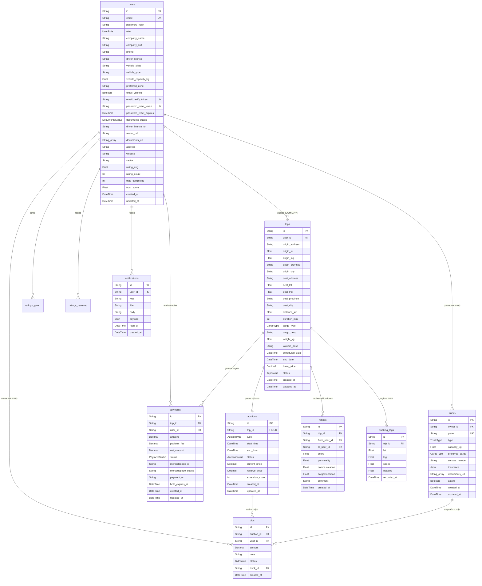

# Modelo de Base de Datos y Entidades — Spottruck

Documentación completa del esquema de base de datos PostgreSQL del sistema Spottruck, administrado mediante Prisma ORM.

---

## 📊 Diagrama Entidad-Relación (Mermaid ERD)

---

## 🔠 Enumeraciones (Enums)

### 1. `UserRole`
Define los roles y permisos en el control de acceso del sistema (RBAC):
- `COMPANY`: Empresa dante de carga que publica viajes.
- `DRIVER`: Transportista de carga pesada que realiza ofertas.
- `ADMIN`: Administrador con privilegios de moderación y auditoría.

### 2. `CargoType`
Tipo de mercadería o carga a transportar:
- `BULK`: Carga a granel (grano, arena, minerales).
- `PALLETS`: Mercadería paletizada.
- `GENERAL`: Carga general empaquetada.
- `REFRIGERATED`: Carga refrigerada o congelada.

### 3. `TripStatus`
Estado del ciclo de vida de la publicación del viaje:
- `DRAFT`: Borrador en edición por la empresa.
- `OPEN`: Publicación abierta (previa o simultánea a la subasta).
- `AUCTION`: Viaje en subasta activa recibiendo ofertas.
- `ASSIGNED`: Transportista adjudicado y retenido el pago.
- `IN_PROGRESS`: Camión en ruta hacia destino.
- `DELIVERED`: Mercadería entregada en destino.
- `SETTLED`: Entrega confirmada por la empresa y fondos liberados.
- `CANCELLED`: Viaje cancelado por la empresa o por subasta desierta.

### 4. `AuctionType`
Modalidad del sistema de subasta inversa:
- `OPEN`: Subasta ascendente/descendente abierta (oferta visible).
- `DUTCH`: Subasta holandesa (precio baja automáticamente).
- `SEALED`: Puja a sobre cerrado (ofertas privadas).

### 5. `AuctionStatus`
Estado del ciclo de vida de la subasta:
- `PENDING`: Creada pero aguardando fecha/hora de inicio.
- `OPEN`: Subasta activa recibiendo pujas.
- `CLOSED`: Subasta finalizada por tiempo o adjudicación.
- `SETTLED`: Adjudicación procesada e integrada con pago.
- `CANCELLED`: Subasta cancelada sin adjudicar.

### 6. `PaymentStatus`
Estado del flujo financiero/escrow del pago:
- `PENDING`: Pago creado / orden de pago pendiente en MercadoPago.
- `HELD`: Fondos retenidos en garantía (escrow) al adjudicar el viaje.
- `RELEASED`: Fondos liberados al transportista tras entrega confirmada.
- `REFUNDED`: Reembolso realizado a la empresa por cancelación.
- `DISPUTED`: Pago en disputa por reclamo de carga o servicio.

### 7. `TruckType`
Categorización del tipo de vehículo de transporte de carga:
- `JAULA`, `SEMI`, `TOLVA`, `BATEA`, `FURGON`, `REFRIGERADO`, `PLAYO`, `OTRO`.

### 8. `BidStatus`
Estado de una oferta/puja realizada por un transportista:
- `PENDING`: Oferta activa en consideración.
- `ACCEPTED`: Oferta ganadora aceptada por la empresa.
- `REJECTED`: Oferta no seleccionada o rechazada.
- `WITHDRAWN`: Oferta retirada por el propio transportista.

### 9. `DocumentsStatus`
Estado del trámite de revisión de documentación del transportista:
- `NONE`: Sin documentos presentados.
- `PENDING`: Documentación enviada pendiente de revisión.
- `APPROVED`: Documentación verificada y aprobada.
- `REJECTED`: Documentación rechazada con observaciones.

---

## 🗄️ Descripción Detallada de Entidades y Atributos

### 1. Entidad `User` (Tabla `users`)
Representa a los usuarios del sistema (Empresas, Transportistas y Administradores).

| Atributo | Tipo Prisma | Nulo | Por Defecto | Descripción / Regla de Negocio |
|---|---|---|---|---|
| `id` | `String` (UUID) | ❌ | `uuid()` | Identificador único del usuario (Primary Key). |
| `email` | `String` | ❌ | — | Correo electrónico (Único, usado para login). |
| `passwordHash` | `String` | ❌ | — | Hash seguro de contraseña (`bcrypt`). |
| `role` | `UserRole` | ❌ | `COMPANY` | Rol del usuario (`COMPANY`, `DRIVER`, `ADMIN`). |
| `companyName` | `String?` | ✔️ | `null` | Nombre/Razón Social (para empresas). |
| `companyCuit` | `String?` | ✔️ | `null` | CUIT fiscal de la empresa o transportista. |
| `phone` | `String?` | ✔️ | `null` | Teléfono de contacto directo. |
| `driverLicense` | `String?` | ✔️ | `null` | Número de licencia de conducir (para transportistas). |
| `vehiclePlate` | `String?` | ✔️ | `null` | Patente del vehículo principal. |
| `vehicleType` | `String?` | ✔️ | `null` | Tipo de vehículo predeterminado. |
| `vehicleCapacity` | `Float?` | ✔️ | `null` | Capacidad máxima en kg del vehículo principal. |
| `preferredZone` | `String?` | ✔️ | `null` | Zona habitual de cobertura del transportista. |
| `emailVerified` | `Boolean` | ❌ | `false` | Indica si el correo fue verificado con token. |
| `emailVerifyToken` | `String?` | ✔️ | `null` | Token único de verificación de email. |
| `passwordResetToken` | `String?` | ✔️ | `null` | Token de un solo uso para recupero de clave. |
| `passwordResetExpires` | `DateTime?` | ✔️ | `null` | Fecha/hora de expiración del token de recupero. |
| `documentsStatus` | `DocumentsStatus` | ❌ | `NONE` | Estado de homologación de documentos del chófer. |
| `driverLicenseUrl` | `String?` | ✔️ | `null` | URL de la imagen/PDF de la licencia. |
| `avatarUrl` | `String?` | ✔️ | `null` | Foto de perfil (`/uploads/avatars/<id>.<ext>`); único archivo público. |
| `documentsUrl` | `String[]` | ❌ | `[]` | Documentos de verificación subidos (`/uploads/documents/<id>/...`); se descargan autenticados vía `/api/v1/files`. |
| `address` | `String?` | ✔️ | `null` | Dirección comercial o fiscal. |
| `website` | `String?` | ✔️ | `null` | Sitio web institucional. |
| `sector` | `String?` | ✔️ | `null` | Rubro industrial de la empresa. |
| `ratingAvg` | `Float` | ❌ | `0` | Promedio de calificaciones recibidas (1.0 - 5.0). |
| `ratingCount` | `Int` | ❌ | `0` | Cantidad total de calificaciones recibidas. |
| `tripsCompleted` | `Int` | ❌ | `0` | Total de viajes finalizados con éxito. |
| `trustScore` | `Float` | ❌ | `0.5` | Puntuación de confianza (0.0 a 1.0). |
| `createdAt` | `DateTime` | ❌ | `now()` | Fecha y hora de registro. |
| `updatedAt` | `DateTime` | ❌ | `updatedAt` | Fecha y hora de última modificación. |

---

### 2. Entidad `Truck` (Tabla `trucks`)
Representa la flota de vehículos registrados por cada transportista (`DRIVER`).

| Atributo | Tipo Prisma | Nulo | Por Defecto | Descripción / Regla de Negocio |
|---|---|---|---|---|
| `id` | `String` (UUID) | ❌ | `uuid()` | Identificador único del camión (Primary Key). |
| `ownerId` | `String` (UUID) | ❌ | — | ID del usuario transportista dueño (`User.id`). |
| `plate` | `String` | ❌ | — | Patente del camión (Única en el sistema). |
| `type` | `TruckType` | ❌ | — | Tipo de carrocería (`JAULA`, `SEMI`, `TOLVA`, etc.). |
| `capacityKg` | `Float` | ❌ | — | Capacidad de carga neta en kilogramos. |
| `preferredCargo` | `CargoType?` | ✔️ | `null` | Tipo de carga preferida o adaptada. |
| `senasaNumber` | `String?` | ✔️ | `null` | Habilitación SENASA para transporte alimenticio. |
| `insurance` | `Json?` | ✔️ | `null` | Datos de póliza (Aseguradora, Vencimiento, Poliza). |
| `documentsUrl` | `String[]` | ❌ | `[]` | Documentos del camión (`/uploads/documents/trucks/<truckId>/...`); descarga autenticada (dueño/admin) vía `/api/v1/files`. |
| `active` | `Boolean` | ❌ | `true` | Estado activo/inactivo del vehículo. |
| `createdAt` | `DateTime` | ❌ | `now()` | Fecha de registro en la flota. |
| `updatedAt` | `DateTime` | ❌ | `updatedAt` | Fecha de última actualización. |

---

### 3. Entidad `Trip` (Tabla `trips`)
Representa la solicitud de flete/viaje publicada por una empresa.

| Atributo | Tipo Prisma | Nulo | Por Defecto | Descripción / Regla de Negocio |
|---|---|---|---|---|
| `id` | `String` (UUID) | ❌ | `uuid()` | Identificador único del viaje (Primary Key). |
| `userId` | `String` (UUID) | ❌ | — | ID de la empresa dante de carga (`User.id`). |
| `originAddress` | `String` | ❌ | — | Dirección exacta de origen/carga. |
| `originLat` | `Float` | ❌ | — | Latitud geográfica del punto de origen. |
| `originLng` | `Float` | ❌ | — | Longitud geográfica del punto de origen. |
| `originProvince` | `String?` | ✔️ | `null` | Provincia de origen. |
| `originCity` | `String?` | ✔️ | `null` | Ciudad/Localidad de origen. |
| `destAddress` | `String` | ❌ | — | Dirección exacta de destino/descarga. |
| `destLat` | `Float` | ❌ | — | Latitud geográfica del punto de destino. |
| `destLng` | `Float` | ❌ | — | Longitud geográfica del punto de destino. |
| `destProvince` | `String?` | ✔️ | `null` | Provincia de destino. |
| `destCity` | `String?` | ✔️ | `null` | Ciudad/Localidad de destino. |
| `distanceKm` | `Float?` | ✔️ | `null` | Distancia total calculada en kilómetros. |
| `durationMin` | `Int?` | ✔️ | `null` | Tiempo estimado de tránsito en minutos. |
| `cargoType` | `CargoType` | ❌ | — | Tipo de carga requerida (`BULK`, `PALLETS`, etc.). |
| `cargoDesc` | `String?` | ✔️ | `null` | Descripción detallada de la mercadería. |
| `weightKg` | `Float?` | ✔️ | `null` | Peso total de la carga en kilogramos. |
| `volumeDesc` | `String?` | ✔️ | `null` | Descripción de volumen o metraje cúbico. |
| `scheduledDate` | `DateTime` | ❌ | — | Fecha y hora pactada de carga en origen. |
| `endDate` | `DateTime?` | ✔️ | `null` | Fecha límite para finalizar la subasta/recibir ofertas. |
| `basePrice` | `Decimal(12,2)` | ❌ | — | Precio tope/base propuesto para el flete ($ ARS). |
| `status` | `TripStatus` | ❌ | `DRAFT` | Estado actual del viaje en el flujo de trabajo. |
| `createdAt` | `DateTime` | ❌ | `now()` | Fecha de creación del borrador/viaje. |
| `updatedAt` | `DateTime` | ❌ | `updatedAt` | Fecha de última modificación. |

---

### 4. Entidad `Auction` (Tabla `auctions`)
Gestiona la subasta inversa asociada a una publicación de viaje.

| Atributo | Tipo Prisma | Nulo | Por Defecto | Descripción / Regla de Negocio |
|---|---|---|---|---|
| `id` | `String` (UUID) | ❌ | `uuid()` | Identificador único de la subasta (Primary Key). |
| `tripId` | `String` (UUID) | ❌ | — | ID del viaje asociado (`Trip.id`, Único 1:1). |
| `type` | `AuctionType` | ❌ | `OPEN` | Modalidad de puja (`OPEN`, `DUTCH`, `SEALED`). |
| `startTime` | `DateTime` | ❌ | — | Hora exacta de inicio de recepción de pujas. |
| `endTime` | `DateTime` | ❌ | — | Hora exacta de cierre (puede ser extendida por anti-sniping). |
| `status` | `AuctionStatus` | ❌ | `PENDING` | Estado de la subasta (`PENDING`, `OPEN`, `CLOSED`, `SETTLED`, `CANCELLED`). |
| `currentPrice` | `Decimal(12,2)` | ❌ | — | Mejor oferta actual en la subasta (monto más bajo). |
| `reservePrice` | `Decimal(12,2)?` | ✔️ | `null` | Precio piso aceptable configurado por la empresa. |
| `extensionCount` | `Int` | ❌ | `0` | Cantidad de prórrogas automáticas por regla anti-sniping. |
| `createdAt` | `DateTime` | ❌ | `now()` | Fecha de creación de la subasta. |
| `updatedAt` | `DateTime` | ❌ | `updatedAt` | Fecha de última actualización. |

---

### 5. Entidad `Bid` (Tabla `bids`)
Representa cada oferta enviada por un transportista en una subasta.

| Atributo | Tipo Prisma | Nulo | Por Defecto | Descripción / Regla de Negocio |
|---|---|---|---|---|
| `id` | `String` (UUID) | ❌ | `uuid()` | Identificador único de la puja (Primary Key). |
| `auctionId` | `String` (UUID) | ❌ | — | ID de la subasta a la que pertenece (`Auction.id`). |
| `userId` | `String` (UUID) | ❌ | — | ID del transportista que oferta (`User.id`). |
| `amount` | `Decimal(12,2)` | ❌ | — | Monto ofertado por el flete (debe ser menor al precio base/actual). |
| `note` | `String?` | ✔️ | `null` | Aclaraciones del transportista al ofertar. |
| `status` | `BidStatus` | ❌ | `PENDING` | Estado de la puja (`PENDING`, `ACCEPTED`, `REJECTED`, `WITHDRAWN`). |
| `truckId` | `String` (UUID)? | ✔️ | `null` | Vehículo de la flota ofrecido para realizar el viaje (`Truck.id`). |
| `createdAt` | `DateTime` | ❌ | `now()` | Fecha y hora de recepción de la oferta. |

---

### 6. Entidad `Payment` (Tabla `payments`)
Registra las transacciones financieras y la retención en garantía (*escrow*).

| Atributo | Tipo Prisma | Nulo | Por Defecto | Descripción / Regla de Negocio |
|---|---|---|---|---|
| `id` | `String` (UUID) | ❌ | `uuid()` | Identificador único de la transacción (Primary Key). |
| `tripId` | `String` (UUID) | ❌ | — | ID del viaje adjudicado (`Trip.id`). |
| `userId` | `String` (UUID) | ❌ | — | ID del pagador (Empresa). |
| `amount` | `Decimal(12,2)` | ❌ | — | Monto total del viaje adjudicado ($ ARS). |
| `platformFee` | `Decimal(12,2)` | ❌ | — | Comisión retenida por la plataforma Spottruck (8%). |
| `netAmount` | `Decimal(12,2)` | ❌ | — | Monto neto a acreditar al transportista (`amount - platformFee`). |
| `status` | `PaymentStatus` | ❌ | `PENDING` | Estado del pago (`PENDING`, `HELD`, `RELEASED`, `REFUNDED`, `DISPUTED`). |
| `mercadopagoId` | `String?` | ✔️ | `null` | ID de pago asignado por la API de MercadoPago. |
| `mercadopagoStatus` | `String?` | ✔️ | `null` | Estado nativo devuelto por la pasarela MP. |
| `paymentUrl` | `String?` | ✔️ | `null` | Link de checkout generado para abonar la retención. |
| `holdExpiresAt` | `DateTime?` | ✔️ | `null` | Fecha límite para completar el depósito en garantía. |
| `createdAt` | `DateTime` | ❌ | `now()` | Fecha de generación de la orden de pago. |
| `updatedAt` | `DateTime` | ❌ | `updatedAt` | Fecha de actualización del estado financiero. |

---

### 7. Entidad `Rating` (Tabla `ratings`)
Almacena la evaluación bidireccional entre la Empresa y el Transportista tras concluir el flete.

| Atributo | Tipo Prisma | Nulo | Por Defecto | Descripción / Regla de Negocio |
|---|---|---|---|---|
| `id` | `String` (UUID) | ❌ | `uuid()` | Identificador único de la evaluación (Primary Key). |
| `tripId` | `String` (UUID) | ❌ | — | ID del viaje finalizado (`Trip.id`). |
| `fromUserId` | `String` (UUID) | ❌ | — | ID del usuario evaluador (`User.id`). |
| `toUserId` | `String` (UUID) | ❌ | — | ID del usuario evaluado (`User.id`). |
| `score` | `Float` | ❌ | — | Calificación general (de 1.0 a 5.0). |
| `punctuality` | `Float?` | ✔️ | `null` | Desglose: Puntualidad en carga y entrega (1.0 - 5.0). |
| `communication` | `Float?` | ✔️ | `null` | Desglose: Calidad de atención y respuesta (1.0 - 5.0). |
| `cargoCondition` | `Float?` | ✔️ | `null` | Desglose: Cuidado y estado de la mercadería (1.0 - 5.0). |
| `comment` | `String?` | ✔️ | `null` | Opinión o reseña escrita. |
| `createdAt` | `DateTime` | ❌ | `now()` | Fecha de emisión de la reseña. |

---

### 8. Entidad `TrackingLog` (Tabla `tracking_logs`)
Registra la telemetría y coordenadas GPS transmitidas en tiempo real durante el viaje.

| Atributo | Tipo Prisma | Nulo | Por Defecto | Descripción / Regla de Negocio |
|---|---|---|---|---|
| `id` | `String` (UUID) | ❌ | `uuid()` | Identificador único de la lectura GPS (Primary Key). |
| `tripId` | `String` (UUID) | ❌ | — | ID del viaje en tránsito (`Trip.id`). |
| `lat` | `Float` | ❌ | — | Latitud geográfica. |
| `lng` | `Float` | ❌ | — | Longitud geográfica. |
| `speed` | `Float?` | ✔️ | `null` | Velocidad calculada del vehículo en km/h. |
| `heading` | `Float?` | ✔️ | `null` | Orientación / rumbo en grados (0° a 360°). |
| `recordedAt` | `DateTime` | ❌ | `now()` | Fecha y hora de captura del dato GPS. |

---

### 9. Entidad `Notification` (Tabla `notifications`)
Notificaciones internas enviadas al usuario sobre cambios de estado y subastas.

| Atributo | Tipo Prisma | Nulo | Por Defecto | Descripción / Regla de Negocio |
|---|---|---|---|---|
| `id` | `String` (UUID) | ❌ | `uuid()` | Identificador único de la notificación (Primary Key). |
| `userId` | `String` (UUID) | ❌ | — | ID del usuario destinatario (`User.id`). |
| `type` | `String` | ❌ | — | Tipo de evento (`NEW_BID`, `BID_ACCEPTED`, `TRIP_STATE`, `AUCTION_CLOSED`). |
| `title` | `String` | ❌ | — | Título del mensaje. |
| `body` | `String?` | ✔️ | `null` | Detalle explicativo de la notificación. |
| `payload` | `Json?` | ✔️ | `null` | Objeto JSON con referencias navegables (`tripId`, `auctionId`, etc.). |
| `readAt` | `DateTime?` | ✔️ | `null` | Fecha/hora en la que el usuario leyó la notificación. |
| `createdAt` | `DateTime` | ❌ | `now()` | Fecha de emisión. |
