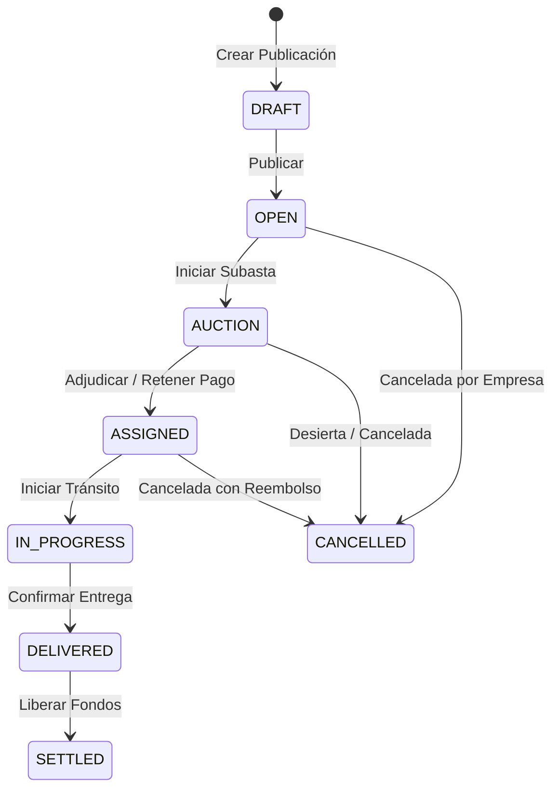

# Entidades y Reglas de Negocio — Spottruck

Documentación comprensiva del modelo de dominio, lógica de negocio y reglas de negocio (invariantes) que rigen el sistema **Spottruck**.

---

## 📐 Visión General del Dominio

**Spottruck** es una plataforma SaaS de logística pesada basada en **subastas inversas** para el transporte de carga en Argentina. Conecta a **Empresas dantes de carga** (`COMPANY`) con **Transportistas** (`DRIVER`) a través de un ecosistema digital de alta confiabilidad que incluye retención de fondos en garantía (*escrow*), telemetría GPS en tiempo real, validación documental y calificaciones bidireccionales.

---

## 🗂️ Índice de Entidades

1. [User (Usuario)](#1-entidad-user-usuario)
2. [Truck (Camión / Vehículo)](#2-entidad-truck-camión--vehículo)
3. [Trip (Viaje / Publicación de Flete)](#3-entidad-trip-viaje--publicación-de-flete)
4. [Auction (Subasta Inversa)](#4-entidad-auction-subasta-inversa)
5. [Bid (Puja / Oferta de Transportista)](#5-entidad-bid-puja--oferta-de-transportista)
6. [Payment (Pago / Escrow)](#6-entidad-payment-pago--escrow)
7. [Rating (Calificación y Reputación)](#7-entidad-rating-calificación-y-reputación)
8. [TrackingLog (Telemetría / GPS)](#8-entidad-trackinglog-telemetría--gps)
9. [Notification (Notificación del Sistema)](#9-entidad-notification-notificación-del-sistema)

---

## 👤 1. Entidad `User` (Usuario)

### 📌 Definición y Propósito
Representa a todos los actores del sistema. La cuenta de usuario abstrae tanto la identidad de acceso (credenciales y autenticación) como el perfil operacional (`COMPANY`, `DRIVER` o `ADMIN`).

### 🔑 Atributos Clave
- `id`: UUID único.
- `email`: Correo electrónico institucional o personal (único).
- `passwordHash`: Hash bcrypt de la contraseña.
- `role`: Enum `UserRole` (`COMPANY`, `DRIVER`, `ADMIN`).
- `companyName`, `companyCuit`: Datos corporativos fiscales.
- `driverLicense`, `vehiclePlate`, `vehicleType`, `vehicleCapacityKg`, `preferredZone`: Perfil de transportista.
- `documentsStatus`: Enum `DocumentsStatus` (`NONE`, `PENDING`, `APPROVED`, `REJECTED`).
- `ratingAvg`, `ratingCount`, `tripsCompleted`, `trustScore`: Métricas de reputación acumuladas.

### ⚙️ Lógica de Negocio Responsable
- **Gestión de Identidad y Autenticación:** Registro con hashing bcrypt, emisión/renovación de Tokens JWT (Access 15m, Refresh 7d) y verificación de correo por token expirables.
- **Homologación Documental:** Transición de estado documental de choferes antes de operar en la plataforma.
- **Cálculo de Trust Score (Puntuación de Confianza):** Algoritmo nocturno/post-viaje que pondera `ratingAvg`, tasa de cumplimiento de viajes y antigüedad.

### 🚨 Reglas de Negocio Estrictas
1. **Unicidad de Email:** No pueden existir dos usuarios con el mismo correo electrónico en el sistema.
2. **Segregación de Roles (RBAC):**
   - Solo usuarios con rol `COMPANY` pueden crear y gestionar viajes (`Trip`).
   - Solo usuarios con rol `DRIVER` pueden registrar vehículos (`Truck`) y enviar ofertas (`Bid`).
   - El rol `ADMIN` tiene facultades exclusivas de moderación, auditoría y resolución de disputas.
3. **Requisito de Homologación Documental:** Para que un `DRIVER` pueda realizar una oferta (`Bid`), su atributo `documentsStatus` debe ser `APPROVED`. Un chofer con documentos en `PENDING`, `REJECTED` o `NONE` tiene bloqueado el envío de ofertas.
4. **Verificación de Email:** El correo debe estar verificado (`emailVerified == true`) para operar transacciones financieras o publicar viajes.
5. **Invariantes de Reputación:** `ratingAvg` se mantiene estrictamente en el rango `[0.0, 5.0]` y `trustScore` en el rango `[0.0, 1.0]`.

---

## 🚛 2. Entidad `Truck` (Camión / Vehículo)

### 📌 Definición y Propósito
Representa un vehículo de carga pesada perteneciente a la flota de un transportista (`DRIVER`).

### 🔑 Atributos Clave
- `id`: UUID único.
- `ownerId`: Referencia FK al usuario dueño (`User.id`).
- `plate`: Patente/Dominio del vehículo (única en el sistema).
- `type`: Enum `TruckType` (`JAULA`, `SEMI`, `TOLVA`, `BATEA`, `FURGON`, `REFRIGERADO`, `PLAYO`, `OTRO`).
- `capacityKg`: Capacidad neta de carga en kilogramos.
- `preferredCargo`: Tipo de carga óptima (Enum `CargoType`).
- `senasaNumber`: Matrícula SENASA opcional para transporte de alimentos/hacienda.
- `insurance`: Objeto JSON con datos de la póliza (Aseguradora, Vencimiento, Número).
- `active`: Estado operativo del vehículo.

### ⚙️ Lógica de Negocio Responsable
- **Verificación de Flota:** Almacenamiento y auditoría de la capacidad del vehículo para match de viajes.
- **Validación Sanitaria/Seguros:** Certificación de idoneidad para cargas refrigeradas o a granel.

### 🚨 Reglas de Negocio Estrictas
1. **Titularidad Exclusiva:** El `ownerId` debe corresponder obligatoriamente a un usuario con rol `DRIVER`.
2. **Unicidad de Patente:** No se permite registrar una patente (`plate`) duplicada en el sistema.
3. **Invariante de Capacidad:** `capacityKg` debe ser mayor a cero.
4. **Asignación a Pujas:** Un camión solo puede ser asignado a una oferta (`Bid`) si su estado es `active == true`.
5. **Compatibilidad de Carga:** Si un viaje requiere `CargoType == REFRIGERATED` o `BULK` con certificación, el camión debe contar con el atributo correspondiente habilitado (ej. `senasaNumber` presente si aplica).

---

## 📦 3. Entidad `Trip` (Viaje / Publicación de Flete)

### 📌 Definición y Propósito
Representa la solicitud de flete o viaje de carga publicada por una empresa dante de carga (`COMPANY`).

### 🔑 Atributos Clave
- `id`: UUID único.
- `userId`: Referencia FK a la empresa creadora (`User.id`).
- `originAddress`, `originLat`, `originLng`, `originProvince`, `originCity`: Datos geográficos de origen.
- `destAddress`, `destLat`, `destLng`, `destProvince`, `destCity`: Datos geográficos de destino.
- `distanceKm`, `durationMin`: Métricas de ruta.
- `cargoType`: Enum `CargoType` (`BULK`, `PALLETS`, `GENERAL`, `REFRIGERATED`).
- `weightKg`, `cargoDesc`, `volumeDesc`: Especificaciones de la mercadería.
- `scheduledDate`: Fecha y hora pactada para la carga.
- `basePrice`: Precio máximo/base a pagar por la empresa (`Decimal(12,2)`).
- `status`: Enum `TripStatus` (`DRAFT`, `OPEN`, `AUCTION`, `ASSIGNED`, `IN_PROGRESS`, `DELIVERED`, `SETTLED`, `CANCELLED`).

### ⚙️ Lógica de Negocio Responsable
- **Ciclo de Vida de la Publicación:** Gestión del estado operacional desde el borrador hasta la liquidación final.
- **Cálculo de Distancias:** Integración con servicios cartográficos/OSM para determinar `distanceKm` y `durationMin`.

### 🔄 Ciclo de Estados (`TripStatus`)

### 🚨 Reglas de Negocio Estrictas
1. **Restricción de Creador:** Solo usuarios con rol `COMPANY` pueden ser propietarios (`userId`) de un viaje.
2. **Coordenadas Obligatorias:** No se permite publicar un viaje sin latitud y longitud válidas de origen y destino.
3. **Precio Base Positivo:** `basePrice` debe ser un monto positivo mayor a cero expresado con precisión decimal.
4. **Fechas Futuras:** La fecha programada de carga (`scheduledDate`) debe ser posterior a la fecha/hora de creación.
5. **Bloqueo de Edición:** Una vez que el viaje entra en estado `AUCTION`, `ASSIGNED` o posterior, sus atributos de ruta, carga y precio base no pueden ser modificados.

---

## 🔨 4. Entidad `Auction` (Subasta Inversa)

### 📌 Definición y Propósito
Representa el proceso de subasta inversa en el cual los transportistas compiten ofreciendo precios menores para adjudicarse el flete.

### 🔑 Atributos Clave
- `id`: UUID único.
- `tripId`: Relación 1:1 con el viaje (`Trip.id`, único).
- `type`: Enum `AuctionType` (`OPEN`, `DUTCH`, `SEALED`).
- `startTime`, `endTime`: Ventana temporal de la subasta.
- `status`: Enum `AuctionStatus` (`PENDING`, `OPEN`, `CLOSED`, `SETTLED`, `CANCELLED`).
- `currentPrice`: Monto de la mejor oferta actual (`Decimal(12,2)`).
- `reservePrice`: Precio mínimo aceptable opcional.
- `extensionCount`: Contador de prórrogas aplicadas por anti-sniping.

### ⚙️ Lógica de Negocio Responsable
- **Mecanismo Anti-Sniping:** Extensión automática del `endTime` si se recibe una puja cerca del cierre para evitar tácticas especulativas de último segundo.
- **Gestión de Modalidades:** Subasta ascendente/descendente abierta, holandesa o a sobre cerrado.
- **Cierre Automático:** Transición a `CLOSED` y adjudicación o declaración de subasta desierta al expirar el tiempo.

### 🚨 Reglas de Negocio Estrictas
1. **Relación Unívoca 1:1:** Cada `Trip` puede tener como máximo una `Auction` asociada.
2. **Ventana Temporal Válida:** `endTime` debe ser estrictamente posterior a `startTime`.
3. **Mecanismo Anti-Sniping:** Si se ingresa una oferta válida dentro de los últimos 5 minutos del `endTime`, la subasta extiende automáticamente su `endTime` en 2 minutos adicionales e incrementa `extensionCount`.
4. **Actualización del Precio Actual:** En subastas de tipo `OPEN`, `currentPrice` se actualiza al monto de la última oferta recibida siempre que sea estrictamente menor a la oferta anterior.
5. **No Cancelación con Ofertas:** Una subasta en estado `OPEN` que ya ha recibido ofertas válidas no puede ser cancelada arbitrariamente sin penalización.

---

## 💰 5. Entidad `Bid` (Puja / Oferta de Transportista)

### 📌 Definición y Propósito
Representa una oferta económica enviada por un transportista (`DRIVER`) para realizar el flete de una subasta específica.

### 🔑 Atributos Clave
- `id`: UUID único.
- `auctionId`: Referencia FK a la subasta (`Auction.id`).
- `userId`: Referencia FK al transportista que oferta (`User.id`).
- `amount`: Monto total ofertado por el flete (`Decimal(12,2)`).
- `note`: Aclaraciones del chofer.
- `status`: Enum `BidStatus` (`PENDING`, `ACCEPTED`, `REJECTED`, `WITHDRAWN`).
- `truckId`: Referencia FK opcional al vehículo asignado (`Truck.id`).

### ⚙️ Lógica de Negocio Responsable
- **Validación de Oferta:** Verificación de decremento contra la puja actual o el precio base del viaje.
- **Adjudicación:** Al aceptarse una puja (`ACCEPTED`), las demás pujas de la subasta pasan automáticamente a `REJECTED`.

### 🚨 Reglas de Negocio Estrictas
1. **Decremento de Oferta (Subasta Inversa):** El monto ofertado (`amount`) debe ser estrictamente menor que el `currentPrice` de la subasta (o `basePrice` si es la primera oferta).
2. **Autopuja Prohibida:** El creador del viaje (la empresa) no puede enviar ofertas a su propia subasta.
3. **Unicidad de Puja Activa:** Un transportista no puede tener múltiples ofertas en estado `PENDING` simultáneamente en la misma subasta (debe superar su propia oferta anterior).
4. **Vehículo Válido y Compatible:** Si se especifica `truckId`, este debe pertenecer al `userId` emisor y tener capacidad suficiente (`capacityKg >= weightKg` del viaje).
5. **Immutabilidad Post-Cierre:** No se pueden enviar ni retirar pujas si la subasta no está en estado `OPEN`.

---

## 💳 6. Entidad `Payment` (Pago / Escrow)

### 📌 Definición y Propósito
Registra el flujo financiero del viaje, garantizando la custodia temporal de fondos (*escrow*) mediante MercadoPago para proteger a ambas partes.

### 🔑 Atributos Clave
- `id`: UUID único.
- `tripId`: Referencia FK al viaje (`Trip.id`).
- `userId`: Referencia FK al pagador (Empresa, `User.id`).
- `amount`: Monto total bruto del flete adjudicado (`Decimal(12,2)`).
- `platformFee`: Comisión retenida por Spottruck (8% por defecto).
- `netAmount`: Monto neto a liberar al transportista (`amount - platformFee`).
- `status`: Enum `PaymentStatus` (`PENDING`, `HELD`, `RELEASED`, `REFUNDED`, `DISPUTED`).
- `mercadopagoId`, `mercadopagoStatus`, `paymentUrl`: Integración con pasarela de pago.
- `holdExpiresAt`: Fecha límite de retención en custodia.

### ⚙️ Lógica de Negocio Responsable
- **Cálculo Automático de Comisión:** Aplicación del 8% de comisión sobre la oferta ganadora.
- **Flujo de Escrow:**
  1. Al adjudicar el viaje, la empresa deposita el monto (`HELD`).
  2. El dinero queda retenido durante el transporte.
  3. Tras la entrega confirmada por la empresa (`DELIVERED`), los fondos pasan a `RELEASED` y se transfieren al transportista.

### 🚨 Reglas de Negocio Estrictas
1. **Conservación de Suma:** Siempre debe cumplirse la ecuación financiera: `amount = platformFee + netAmount`.
2. **Retención Previa al Tránsito:** Un viaje no puede pasar a estado `IN_PROGRESS` sin que el pago correspondiente esté verificado en estado `HELD`.
3. **Liberación Condicionada:** La transición de estado a `RELEASED` exige que el viaje esté en estado `DELIVERED` o `SETTLED`.
4. **Reembolso por Cancelación:** En caso de cancelación antes de iniciar el tránsito, el estado pasa a `REFUNDED` devolviendo el saldo neto a la empresa según las políticas de cancelación.

---

## ⭐ 7. Entidad `Rating` (Calificación y Reputación)

### 📌 Definición y Propósito
Almacena la evaluación bidireccional entre la Empresa y el Transportista una vez concluido el servicio de flete.

### 🔑 Atributos Clave
- `id`: UUID único.
- `tripId`: Referencia FK al viaje finalizado (`Trip.id`).
- `fromUserId`: Usuario evaluador (`User.id`).
- `toUserId`: Usuario evaluado (`User.id`).
- `score`: Calificación general (`Float`, de 1.0 a 5.0).
- `punctuality`, `communication`, `cargoCondition`: Desgloses de valoración (1.0 a 5.0).
- `comment`: Reseña textual.

### ⚙️ Lógica de Negocio Responsable
- **Actualización de Promedio:** Al registrar un `Rating`, se recalculan automáticamente `ratingAvg` y `ratingCount` en el perfil del usuario receptor (`toUserId`).
- **Ponderación de Confianza:** Alimenta el algoritmo de `trustScore`.

### 🚨 Reglas de Negocio Estrictas
1. **Unicidad por Parte y Viaje:** Un usuario (`fromUserId`) solo puede calificar a la otra parte (`toUserId`) una única vez por cada `tripId` (Restricción Unique `[tripId, fromUserId]`).
2. **Requisito de Finalización:** Solo se pueden emitir calificaciones para viajes cuyo estado sea `DELIVERED` o `SETTLED`.
3. **Autocalificación Prohibida:** `fromUserId` no puede ser igual a `toUserId`.
4. **Rango de Puntuación:** Todos los valores numéricos de puntuación deben estar estrictamente entre `1.0` y `5.0`.

---

## 📍 8. Entidad `TrackingLog` (Telemetría / GPS)

### 📌 Definición y Propósito
Registra los puntos de geolocalización y velocidad transmitidos por el dispositivo o App del transportista durante el viaje.

### 🔑 Atributos Clave
- `id`: UUID único.
- `tripId`: Referencia FK al viaje (`Trip.id`).
- `lat`, `lng`: Coordenadas geográficas WGS84.
- `speed`: Velocidad calculada en km/h.
- `heading`: Rumbo u orientación en grados (0° a 360°).
- `recordedAt`: Timestamp de captura del GPS.

### ⚙️ Lógica de Negocio Responsable
- **Transmisión en Tiempo Real:** Emisión de eventos vía WebSockets (`ws://`) hacia el panel de la empresa.
- **Histórico de Ruta:** Reconstrucción de la trazabilidad del recorrido del flete.

### 🚨 Reglas de Negocio Estrictas
1. **Emisión Exclusiva en Tránsito:** Solo se aceptan y guardan lecturas GPS para viajes que se encuentren activamente en estado `IN_PROGRESS`.
2. **Validez Geográfica:** `lat` debe estar en `[-90, 90]` y `lng` en `[-180, 180]`.
3. **Frecuencia y Polling:** La aplicación cliente emite coordenadas cada 30 segundos o por cambio significativo de posición.

---

## 🔔 9. Entidad `Notification` (Notificación del Sistema)

### 📌 Definición y Propósito
Almacena y gestiona las alertas enviadas a los usuarios sobre eventos críticos de la plataforma.

### 🔑 Atributos Clave
- `id`: UUID único.
- `userId`: Destinatario (`User.id`).
- `type`: Cadena de tipo de evento (`NEW_BID`, `BID_ACCEPTED`, `TRIP_STATE`, `AUCTION_CLOSED`, etc.).
- `title`, `body`: Mensaje ejecutable/descriptivo.
- `payload`: JSON navegable con IDs de contexto (`tripId`, `auctionId`, etc.).
- `readAt`: Timestamp de lectura (nulo si no ha sido leída).

### ⚙️ Lógica de Negocio Responsable
- **Despacho Multi-canal:** Envío simultáneo vía WebSocket en tiempo real e inserción en la bandeja in-app del usuario.

### 🚨 Reglas de Negocio Estrictas
1. **Privacidad de Destinatario:** Las notificaciones solo son visibles y leíbles por el `userId` correspondiente.
2. **Immutabilidad del Evento:** Una notificación generada no puede ser modificada en su contenido; únicamente se actualiza su campo `readAt`.
